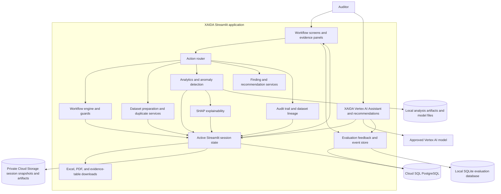
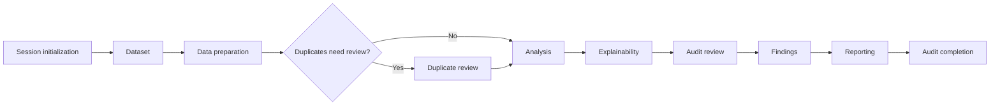
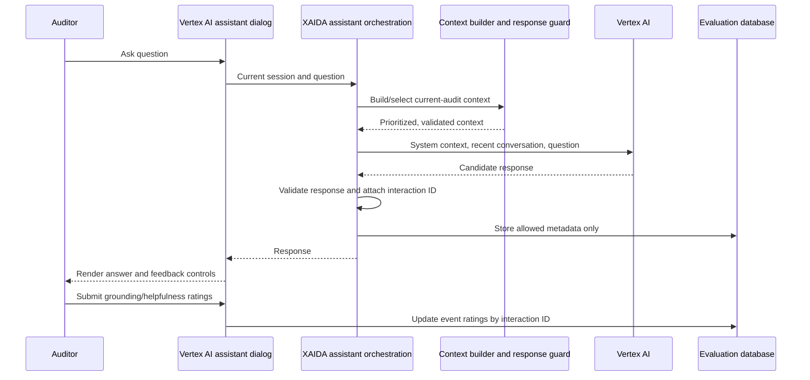
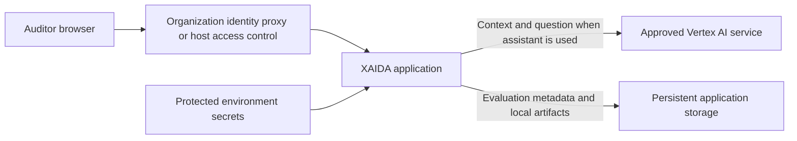

# XAIDA Final Architecture

**Product:** eXplainable AI Data Analytics for Audit (XAIDA)  
**Architecture snapshot:** 2026-11-03  
**Application version recorded in evaluation events:** 1.0  
**Status:** Current implementation with optional Cloud Run persistence

This document describes the application as implemented in this repository. It
does not imply that hosting, identity management, durable audit storage, or
multi-user deployment controls have already been selected or configured.

## 1. Architecture overview

XAIDA is a stage-driven audit analytics application. Auditors use the
Streamlit interface to load a dataset, review processing and anomaly evidence,
make audit decisions, create findings, and produce downloadable reports. The
workflow engine and action router govern state transitions and operations.
The XAIDA Vertex AI Assistant is an optional assistant alongside this
workflow: it provides contextual guidance and recommendations but does not
approve audit decisions or control workflow transitions.

The diagram distinguishes three kinds of state:

1. **Active audit state** is cached in Streamlit session state. When GCS
   persistence is enabled, compressed session snapshots and analysis/model
   artifacts are stored in the private Cloud Storage bucket.
2. **Evaluation events** are stored in SQLite for local development and in
   Cloud SQL PostgreSQL when `XAIDA_DATABASE_BACKEND=postgres`.
3. **Session ownership and expiry metadata** are stored in Cloud SQL. Session
   contents are not stored in evaluation tables.

## 2. Component responsibilities

| Layer | Main implementation | Responsibility |
|---|---|---|
| Application and user interface | `app.py`, `ui/` | Streamlit entry point, stage navigation, dataset and evidence views, Vertex AI assistant dialog, feedback controls, and report/download presentation. |
| Session and audit state | `assistant/audit_session.py`, `assistant/session_manager.py`, `assistant/session_persistence.py` | Creates and caches audit sessions, serializes supported session values, stores owner-bound snapshots in GCS, enforces expiry, and deletes session objects on reset/exit. |
| Workflow governance | `orchestration/workflow_engine.py` | Defines allowable audit-stage transitions, stage guards, workflow status, and next-step guidance. |
| User actions | `assistant/action_router.py` | Maps explicit UI actions to deterministic processing, review, findings, report, and completion operations. |
| Dataset handling | `dataset/` | Loads uploaded or sample data, profiles and prepares data, applies missing-value treatment, detects/resolves duplicates, and tracks dataset versions. |
| Analytics | `analytics/` | Transforms features, performs ensemble anomaly detection and risk scoring, creates explanations, and saves analysis/model artifacts. |
| Explainability | `analytics/explainability.py` | Produces SHAP-based explanation data for flagged records and feature importance. |
| Findings and audit evidence | `findings/`, `audit/` | Manages findings and recommendations, records audit events, and supports change/lineage traceability. |
| Vertex AI assistant | `assistant/copilot.py`, `assistant/context/`, `assistant/prompts/` | Builds a bounded context from the current audit session, classifies and routes questions, generates recommendations or answers with Vertex AI, validates the response, and maintains a short in-memory conversation. |
| AI service configuration | `core/vertex_ai_client.py` | Lazily creates the Vertex AI client using Google Application Default Credentials and protected deployment configuration. |
| Database access | `core/database.py` | Connects to local SQLite for development or Cloud SQL PostgreSQL for Cloud Run. |
| Evaluation metadata | `assistant/evaluation_store.py`, `core/app_metadata.py` | Persists interaction metadata and optional response ratings to SQLite locally or Cloud SQL PostgreSQL in Cloud Run. |
| Report and table exports | `exports/`, `ui/evidence/table_download.py` | Generates Excel/PDF report downloads and CSV downloads of evidence tables. |

## 3. Governed audit workflow

The implemented workflow is stage-driven. A new audit session is initialized
before dataset acquisition. Operations are exposed through UI actions and
dispatched through the action router; the workflow engine validates stage
transitions.

The auditor remains responsible for duplicate treatment, review of flagged
records, findings decisions, and final report/completion decisions. Analytics
results are evidence to assess, not autonomous audit conclusions. After audit
completion, the Reports view remains available, the Vertex AI assistant may still be used
for inquiries, and the completion screen presents an optional anonymous survey
notice. The survey is still being prepared; no link is active, and survey
responses are separate from audit findings, reports, and assistant evaluation
records.

## 4. Vertex AI assistant request and evaluation flow

The assistant context is assembled from the active session and includes
workflow, dataset, preparation, duplicate review, analysis, explainability,
audit review, findings, reporting, lineage, audit trail, methodology, and
platform-help information. The context builder and response guard constrain
what is sent and what responses are accepted. The current conversation is
maintained in memory and recent conversation messages are included in assistant
requests.

When a user asks the Vertex AI assistant a question or requests an AI-generated
recommendation, relevant context is sent to the configured Vertex AI model.
The organization must approve the GCP project, region, data handling terms,
and retention settings before real audit data is used. The default model is
`gemini-3.5-flash-lite`.

## 5. Data and persistence boundaries

### Active audit session

- One `AuditSession` is held in Streamlit state while active. In GCS mode,
  XAIDA autosaves a compressed JSON snapshot to
  `audit-sessions/{session_id}/session.json.gz` and stores a SHA-256 hash of
  the normalized signed-in email plus object metadata in Cloud SQL.
- Snapshot access checks both the random session ID and owner hash. The ID in
  the browser URL is not treated as authorization.
- DataFrames, numpy arrays, SHAP explanations, findings, review decisions,
  conversation, and audit log are round-tripped using a typed JSON codec.
  Unsupported values raise an explicit persistence error rather than being
  silently discarded. Snapshots are capped at 200 MiB compressed.
- Snapshots expire 24 hours after the last successful save. Exit, Reset, and
  New Analysis delete the SQL session row and every GCS object generation
  under the session prefix. Evaluation data is deliberately not deleted by
  these actions.

### Analysis artifacts

- In GCS mode, versioned analysis joblib artifacts and fitted models are
  stored below the same session-specific prefix and deleted with the session.
- In local mode, analysis artifacts and models continue to use local
  filesystem paths.

### Evaluation event database

- Local development uses `data/xaida_evaluations.sqlite3`, configurable with
  `XAIDA_EVALUATION_DB_PATH`.
- Cloud Run selects PostgreSQL with `XAIDA_DATABASE_BACKEND=postgres` and
  connects over the Cloud SQL Unix socket using `CLOUD_SQL_CONNECTION_NAME`,
  `XAIDA_DATABASE_NAME`, `XAIDA_DATABASE_USER`, and the Secret Manager-backed
  `XAIDA_DATABASE_PASSWORD`.
- Each assistant interaction stores a random interaction ID, random
  pseudonymous evaluation-session ID, UTC timestamp, workflow stage, response
  category, latency, success/error outcome, safe error category, optional
  grounding/helpfulness ratings, and app version.
- The fixed schema does **not** store prompts, full responses, dataset rows,
  API keys, evaluator names, or raw exception messages.
- This event log is only for assistant evaluation and operational metadata. It
  is not a general application log, event-sourcing system, or durable audit
  trail.

### Downloads

- Excel and PDF reports are generated as downloads; CSV downloads are available
  for evidence tables.
- Downloads are user-controlled outputs and are not an application archive or
  replacement for approved records management.

## 6. Security, privacy, and deployment boundary

The identity provider, protected secrets, TLS termination, persistent storage,
network controls, backups, and retention policy are hosting responsibilities.
XAIDA itself does not implement login, role-based access control, or an
evaluator identity registry. Evaluation session IDs are pseudonymous and are
not attributable to an auditor by XAIDA.

The local SQLite file is for development only. Cloud Run must use the
configured Cloud SQL PostgreSQL database and GCS session backend; do not rely
on the container filesystem for durable data.

## 7. Deployment view and configuration

The application runs as a Python/Streamlit process from `app.py`, packaged in
the root Dockerfile for Cloud Run. Vertex AI settings are supplied through
protected environment configuration:

- `GOOGLE_CLOUD_PROJECT`
- `GOOGLE_CLOUD_LOCATION`
- `XAIDA_VERTEX_AI_MODEL` (optional; defaults to `gemini-3.5-flash-lite`)
- `XAIDA_VERTEX_AI_APPROVED` (must be explicitly set to `true` after data
  handling approval)
- `XAIDA_DATABASE_BACKEND=postgres`
- `CLOUD_SQL_CONNECTION_NAME`
- `XAIDA_DATABASE_NAME`
- `XAIDA_DATABASE_USER`
- `XAIDA_DATABASE_PASSWORD` (Secret Manager)
- `XAIDA_SESSION_STORAGE_BACKEND=gcs`
- `XAIDA_SESSION_STORAGE_BUCKET`
- `XAIDA_SESSION_RETENTION_HOURS=24`
- `XAIDA_EVALUATION_RETENTION_DAYS`

On Cloud Run, grant the service account Vertex AI User on the approved project;
the Google Gen AI SDK obtains short-lived credentials through Application
Default Credentials. Do not configure a service-account key. The deployment
platform should enforce organization-managed authentication, TLS, access
restrictions, upload-size and memory limits, persistent storage, and approved
monitoring. Logs and alerts must not contain uploaded rows, credentials, full
prompts, full responses, or raw exception details.

## 8. Current constraints and production gates

This architecture describes a working prototype for auditor assessment, not
an already hardened production service. Before real-data deployment:

1. Configure and validate Cloud Run and organization-managed identity controls.
2. Test isolation between two separately authenticated auditors.
3. Approve Vertex AI project access, model/region selection, and data handling
   for intended audit information.
4. Configure and test Cloud SQL PostgreSQL ownership, backups, concurrency,
   and recovery, and configure private GCS with lifecycle and generation
   deletion.
5. Test session save/resume across an instance restart, session ownership
   denial, 24-hour cleanup, Reset/New Analysis/Exit deletion, and preservation
   of evaluation rows using two separate auditor identities.
6. Define deletion, retention, recovery, monitoring, and incident-response
   procedures.
7. Re-run the application tests and verify report downloads and representative
   dataset performance in the target environment.

For operational setup, see [DEPLOYMENT.md](./DEPLOYMENT.md).

┌─────────────────────────────────────────────────────────────┐
│                         AUDITOR                             │
└───────────────────────┬─────────────────────────────────────┘
                        │
                        ▼
┌─────────────────────────────────────────────────────────────┐
│                 XAIDA STREAMLIT APPLICATION                 │
├─────────────────────────────────────────────────────────────┤
│                                                             │
│  ┌─────────────────────────────────────────────────────┐    │
│  │                 User Interface Layer               │    │
│  ├─────────────────────────────────────────────────────┤    │
│  │ • Dashboard                                         │    │
│  │ • Dataset Management                                │    │
│  │ • Evidence Panels                                   │    │
│  │ • Audit Review Screens                              │    │
│  │ • Findings Management                               │    │
│  │ • Report Generation                                 │    │
│  │ • XAIDA Vertex AI Assistant                         │    │
│  └─────────────────────────────────────────────────────┘    │
│                                                             │
│                             │                               │
│                             ▼                               │
│  ┌─────────────────────────────────────────────────────┐    │
│  │             Workflow Governance Layer               │    │
│  ├─────────────────────────────────────────────────────┤    │
│  │ • Action Router                                     │    │
│  │ • Workflow Engine                                   │    │
│  │ • Stage Registry                                    │    │
│  │ • Session Manager                                   │    │
│  │ • Audit Session State                               │    │
│  └─────────────────────────────────────────────────────┘    │
│                                                             │
│                             │                               │
│                             ▼                               │
│  ┌─────────────────────────────────────────────────────┐    │
│  │                Analytics Services Layer             │    │
│  ├─────────────────────────────────────────────────────┤    │
│  │ • Dataset Preparation                               │    │
│  │ • Duplicate Detection                               │    │
│  │ • Feature Engineering                               │    │
│  │ • Ensemble Anomaly Detection                        │    │
│  │ • Risk Scoring                                      │    │
│  │ • SHAP Explainability                               │    │
│  │ • Audit Trail & Dataset Lineage                     │    │
│  │ • Findings & Recommendations                        │    │
│  └─────────────────────────────────────────────────────┘    │
│                                                             │
│                             │                               │
│                             ▼                               │
│  ┌─────────────────────────────────────────────────────┐    │
│  │                  Export Services                    │    │
│  ├─────────────────────────────────────────────────────┤    │
│  │ • PDF Reports                                       │    │
│  │ • Excel Reports                                     │    │
│  │ • Evidence Table Exports                            │    │
│  └─────────────────────────────────────────────────────┘    │
│                                                             │
└─────────────────────────────────────────────────────────────┘

            ┌─────────────────────┼────────────────────┐
            │                     │                    │
            ▼                     ▼                    ▼

┌──────────────────┐  ┌───────────────────┐  ┌──────────────────────┐
│ Active Session   │  │ Analysis Artifacts│  │ Evaluation Store     │
│ State            │  │                   │  │                      │
├──────────────────┤  ├───────────────────┤  ├──────────────────────┤
│ Streamlit cache  │  │ Local files       │  │ SQLite (local)       │
│ GCS snapshots    │  │ GCS (Cloud Run)   │  │ Cloud SQL PostgreSQL │
└──────────────────┘  └───────────────────┘  └──────────────────────┘

                           ┌──────────────────────┐
                           │ Vertex AI Assistant  │
                           │ Context and response │
                           │ validation           │
                           └──────────┬───────────┘
                                      │
                                      ▼
                           ┌──────────────────────┐
                           │ Approved Vertex AI   │
                           │ Gemini model         │
                           └──────────────────────┘

──────────── GOVERNED AUDIT WORKFLOW ────────────

Initialization
      │
      ▼
Dataset Acquisition
      │
      ▼
Data Preparation
      │
      ▼
Duplicate Review
      │
      ▼
Analysis
      │
      ▼
Explainability
      │
      ▼
Audit Review
      │
      ▼
Findings
      │
      ▼
Reporting
      │
      ▼
Audit Completion

┌─────────────────────────────────────────────────────┐
│           ORGANIZATION SECURITY CONTROLS            │
├─────────────────────────────────────────────────────┤
│ • OIDC Authentication                               │
│ • Email Allowlisting                                │
│ • TLS Encryption                                    │
│ • Network Security Controls                         │
│ • Secrets Management                                │
│ • Backup and Retention Controls                     │
│ • Monitoring and Incident Response                  │
│ • Access-Control Policies                           │
│ • Confidential Data Handling Procedures             │
└─────────────────────────────────────────────────────┘
                          │
                          ▼
                    XAIDA Platform